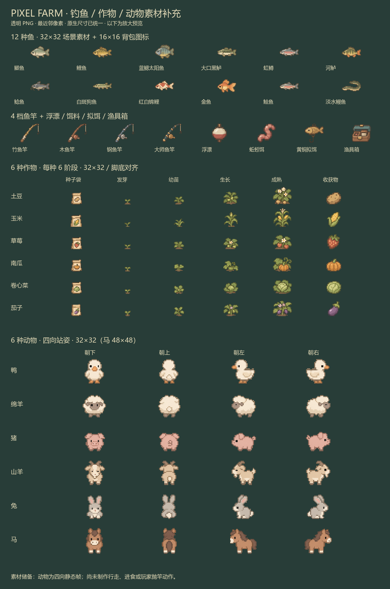

# 钓鱼、作物与动物素材包 v1

通过内置 ImageGen 生成，并由 `tools/prepare_expansion_art.gd` 切片、最近邻缩小和统一落脚点。对应项目现有的低分辨率像素画、柔和农场配色和透明贴图规格。此次只补充美术资源，尚未接入钓鱼、作物生长或动物 AI。



## 内容

| 目录 | 内容 | 规格 |
| --- | --- | --- |
| `fish/` | 鲫鱼、鲤鱼、蓝鳃太阳鱼、大口黑鲈、虹鳟、河鲈、鲶鱼、白斑狗鱼、红白锦鲤、金鱼、鲑鱼、淡水鳗鱼 | 12 张，32×32，鱼头向左 |
| `fishing/` | 竹鱼竿、木鱼竿、钢鱼竿、大师鱼竿、浮漂、蚯蚓饵、黄铜拟饵、渔具箱 | 8 张，32×32 |
| `crops/` | 土豆、玉米、草莓、南瓜、卷心菜、茄子，每种 6 阶段 | 36 张，32×32 |
| `animals/` | 鸭、绵羊、猪、山羊、兔、马，每种朝下、朝上、朝左、朝右 | 24 张独立站姿 + 6 张四向图集；马 48×48，其余 32×32 |
| `icons/` | 12 种鱼、8 件渔具、6 个种子袋、6 个收获物 | 32 张，16×16，适合背包与工具栏 |
| `atlases/` | 鱼类、渔具、作物的合并图集 | 对应独立 PNG，格子均为 32×32 |

共有 112 张独立 PNG，另附 9 张合并图集及一张预览图。已有的胡萝卜、芜菁、番茄、小麦、奶牛和鸡素材保留。

## 命名与坐标

`catalog.json` 给出中英文标识、相对路径、图集坐标、尺寸和动物脚底坐标。路径均相对于本目录，Godot 前缀为 `res://assets/generated/expansion_v1/`。

- 作物：`crops/{crop}_{stage}.png`，阶段依次是 `seeds`（种子袋）、`sprout`（发芽）、`young`（幼苗）、`growing`（生长）、`mature`（成熟植株）、`harvest`（收获物）。
- 作物图集：6 列 × 6 行；列为上述阶段，行依次是 `potato / corn / strawberry / pumpkin / cabbage / eggplant`。种子袋用于 UI，播种后的世界显示从 `sprout` 开始。
- 作物放置：每格 32×32，地面锚点为 `(16, 31)`；使用 `Sprite2D` 的 `centered=false` 时，将精灵偏移设为 `(-16, -31)`。
- 动物：`animals/{species}_{direction}.png`，四向图集的列顺序是 `down / up / left / right`。小动物脚底 `(16, 29)`，马脚底 `(24, 45)`；每个物种四个方向使用统一缩放比例。
- 鱼和渔具：32×32 版本居中；对应的 16×16 图标放在 `icons/`，例如 `icons/bamboo_rod.png` 和 `icons/crucian_carp.png`。
- 鱼和渔具图集分别为 4×3 和 4×2，顺序见 `catalog.json`。

## Godot 中使用

素材导入使用无损 PNG、关闭 mipmaps，并沿用项目的 Nearest 过滤。独立 PNG 可直接拖到 `Sprite2D` 或 `TextureRect`；合并图集可用 `AtlasTexture` 读取。32×32 图块应保持原生像素尺寸，按脚底锚点摆放，避免拉伸到整个 16×16 地块。

动物目前只有四向静态站姿，不包含行走、进食或产出动画。鱼竿是物品图片，不包含玩家抛竿、收线和持竿动画。此资源包没有钓鱼概率、售价或生长天数等玩法数据。

## 原图、提示词与重建

原始大图保存在 `assets/generated/sources/`：

- `fish_icons_v1.png`
- `fishing_gear_v1.png`
- `crops_expansion_v1.png`
- `animals_expansion_v1.png`

完整生成提示词及工具模式见 `prompts.json`。原图保留生成时的 Alpha；运行时切片与已有素材处理器一致，采用最近邻缩小、硬边透明度，不使用平滑插值。切片时还会移除远离主体的相邻格碎片，避免碎片改变缩放比例或混入其他方向。

```bash
godot --headless --path . --script res://tools/prepare_expansion_art.gd
godot --headless --path . --editor --import
godot --path . --script res://tools/preview_expansion_art.gd
```

最后一条会用 Godot 实际渲染素材并更新本目录 `preview.png`。
