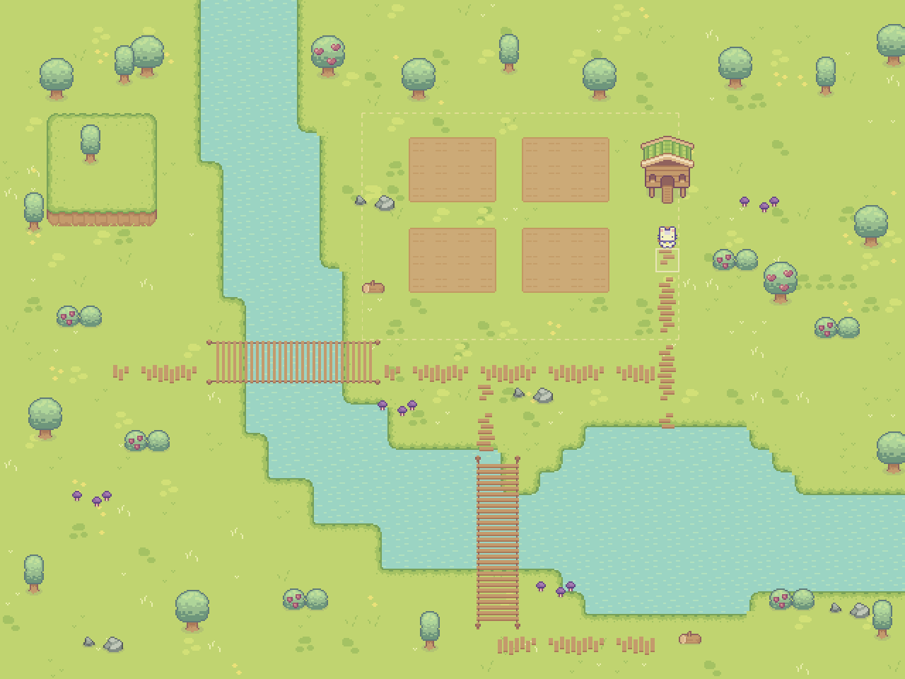

# 河流与地形

地图保持 40×30 格、每格 16×16 像素。北侧河流穿过西侧草地，向东弯入东南池塘，再从东边界流出。西北增加一块带土崖边缘的草坡，屋前木板小路连接种植区外侧、东西向桥与南侧桥。原有四块苗圃和出生点保留。



## 素材与画面

- 水面直接使用 `assets/game/tilesets/water.png` 的四帧动画，每秒 4 帧。
- 岸线来自 `grass.png`：以 8×8 象限组合 256 个邻域图块，处理外角、内角与转弯。透明角下方垫水，避免露出草地底纹。
- 木桥来自 `wood_bridge.png`：保留外侧护栏、端柱与木板纹理，仅重复桥面内部像素，将原本一格宽的桥扩为两格宽。
- 草坡来自 `hills.png`，小路来自 `paths.png`。所有贴图保持原色板和像素尺寸，使用项目现有的最近邻过滤。
- 原始素材包不改动。拼接结果位于 `assets/generated/terrain/river_shore_atlas.png` 与 `river_bridge_atlas.png`。

## 布局与碰撞

地形布局统一放在 `tools/lib/farm_landscape.gd`，地图入口仍是 `tools/build/build_farm_map.gd`。

| 区域 | 格子范围 | 行为 |
| --- | --- | --- |
| 东西向木桥 | x=9–16，y=15–16 | 连接西侧草地和农田外侧小路 |
| 南北向木桥 | x=21–22，y=21–25 | 连接池塘北岸和南岸 |
| 西北草坡 | x=2–6，y=5–9 | 装饰性高地，崖壁阻挡移动，暂不提供上坡入口 |
| 原有种植区 | x=16–29，y=5–14 | 保留原有锄地、浇水判定 |

222 个水格共享同一份数据生成画面和碰撞。桥面覆盖的水格移除水碰撞，并添加侧面护栏碰撞，允许沿桥双向通行。岸线图层负责视觉过渡，河道内部始终不可步行。移动了落入河道的旧道具及挡住桥口的树木。

南北桥的宽度固定为两格，因此两处细节必须同步：

- 水域在 `x=21` 的 `y=20–21` 收回到岸边，让 `x=21–22` 两列同时从 `y=22` 开始有水；否则两格宽的桥会有一半压在岸上，桥头看起来歪向一侧。
- 引路同样铺满两格并接在桥头（北侧 `x=21–22, y=18–20`，南侧 `x=21–28, y=26–28`，遇水格跳过）。南北走向的引路使用 `paths.png` 第 0 列的横板图块，水平路段用第 3 行的竖板图块，混用会拼成一截截错开的木棍。

引路与桥面在铺瓦时被排除在可开垦范围之外，锄头不会把小路的木板挖掉。

## 重建与验收

通常修改布局后只需重建地图：

```bash
godot --headless --path . --script res://tools/build/build_farm_map.gd
```

修改素材拼接算法时，先重新生成并导入图集：

```bash
godot --headless --path . --script res://tools/art/prepare_terrain_art.gd
godot --headless --path . --editor --import
godot --headless --path . --script res://tools/build/build_farm_map.gd
```

验收命令：

```bash
godot --headless --path . --script res://tools/check/smoke_check.gd
godot --headless --path . --script res://tools/check/check_farm_interactions.gd
godot --headless --path . --script res://tools/check/check_farm_terrain.gd
```

地形验收会进入真实物理世界，检查所有水格和桥格的碰撞、两座桥的双向穿越、四侧护栏、出生点、坡地阻挡、道具落脚位置，以及从出生点到西岸、南岸、农田与池塘岸边的可达性。

输出全图和实机近景截图：

```bash
godot --path . --script res://tools/check/check_farm_terrain.gd -- --preview
```

截图保存到 `user://terrain_previews/`。此模式临时调整测试窗口与相机，不修改项目设置。
