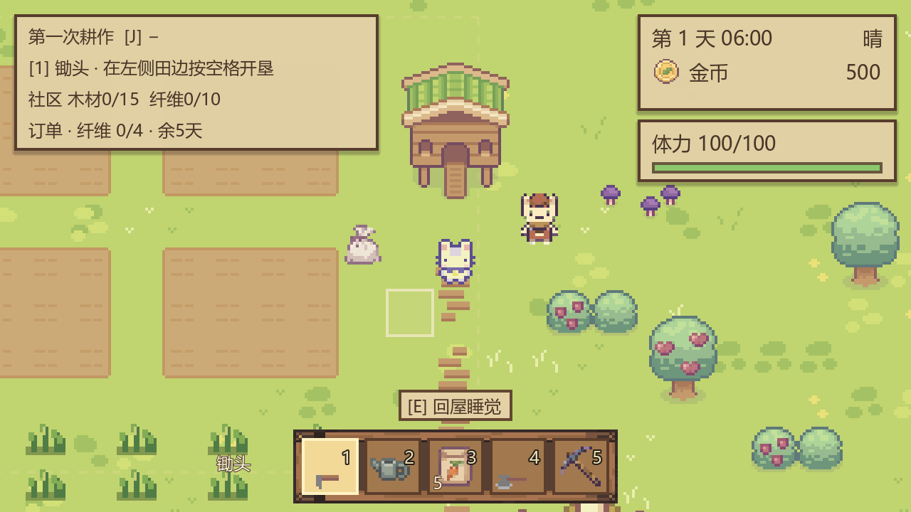
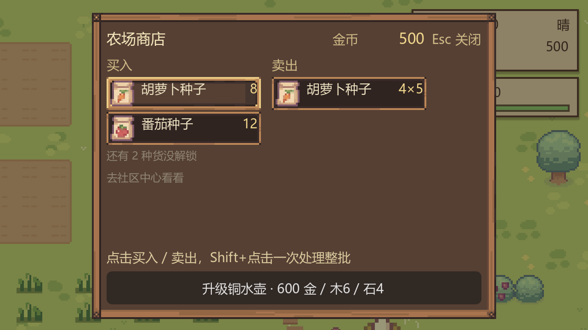
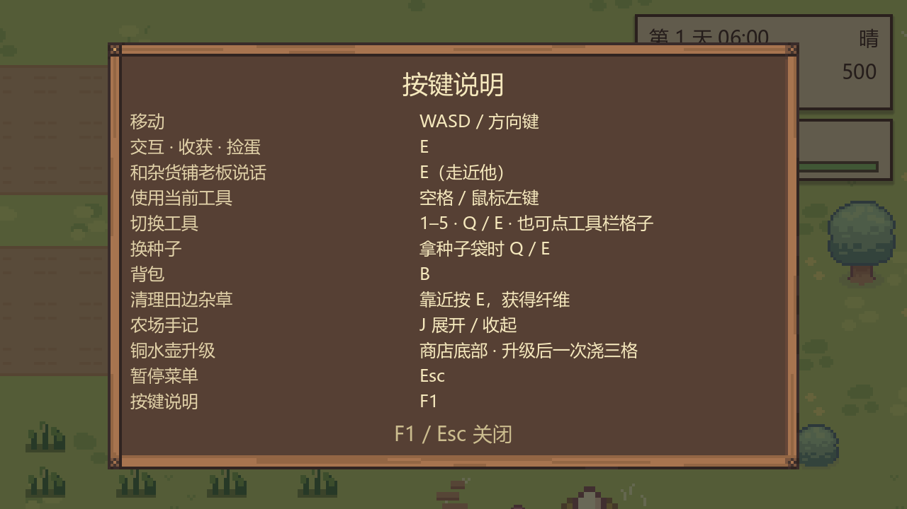

# 循环与界面改进

2026-11-03。范围：补通原有循环，整理 HUD、加入首轮引导和一项效率升级。

## 玩家可见变化

- 右上合并日期、时间、天气与金币，体力显示为带框横条；左上手记显示引导、社区材料与订单期限，可点击标题或按 J 收起。
- 操作提示移到工具栏上方；选中工具显示名称，种子槽显示实际种类与库存；农田范围线仅拿锄头时淡显，面板打开时隐藏。
- 田地南侧十丛杂草，靠近按 E，每丛获得 2 纤维并消耗 2 体力。每日最多补三丛，满包或无体力时不丢草，已经开垦的落点不再长草。采集状态入档。
- 首单收 4 纤维，其他订单从已解锁作物中选择；含出单日保留五天，最后一天仍可交付，超过期限才替换。已完成订单次日换新单。旧订单缺期限时按原出单日补五天。
- 引导由成功操作推进：开垦 → 播种 → 浇水 → 睡觉 → 每天照料直至成熟并收获 → 找老板出售。可直接在初始田地播种，自动跳过开垦步骤。引导进度入档。
- 商店底部升级铜水壶：600 金币、6 木材、4 石头。升级前检查全部资源，失败不扣款；升级后目标与左右两格一起浇水，按角色朝向旋转，一次扣 3 体力。边格无作物不影响有效作物，全部无效不扣体力；升级永久保存。
- 时间累计小数分钟，30/60/144 FPS 下都按现实一分钟推进游戏四小时。面板期间停钟，02:00 弹强制收工结算，确认后进入次日并保存。

## 相关实现

- `scripts/systems/time_system.gd`：帧率独立时钟，睡觉与读档重置余量。
- `scripts/world/forage.gd`、`forage_patch.gd`：可再生纤维与存档。
- `scripts/systems/tutorial.gd`：只由成功操作推进引导。
- `scripts/systems/upgrades.gd`、`data/upgrades/watering_can.tres`：数据驱动的升级价格与效果。
- `assets/generated/ui/farm_hud.tres`：纸色、棕边的状态牌与工具槽主题。
- `scripts/systems/save_system.gd`：新增 `forage`、`tutorial`、`upgrades` 字段，缺字段的旧档正常初始化。

## 验收

`tools/check/check_progression.gd` 覆盖帧率一致性、实际采草取得纤维、订单期限最后一天与过期边界、重复天数不重复再生、升级失败不扣款、三格浇水、首次出售完成引导、存档往返和强制收工。新增检查应在独立测试存档目录运行；现有日历检查会创建与删除当前槽位。

实机截图：

验证记录：14 项功能检查通过，含三种分辨率的布局检查；新版实机运行日志未出现脚本错误。部分无头测试快速退出时仍有原有循环 WAV 的资源释放告警，未影响断言或实机运行。

本轮没有扩展动物照料、作物周期差异、多地图、工具制作和社区完成后的地图改建。
