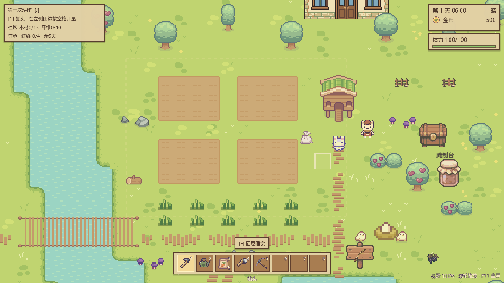
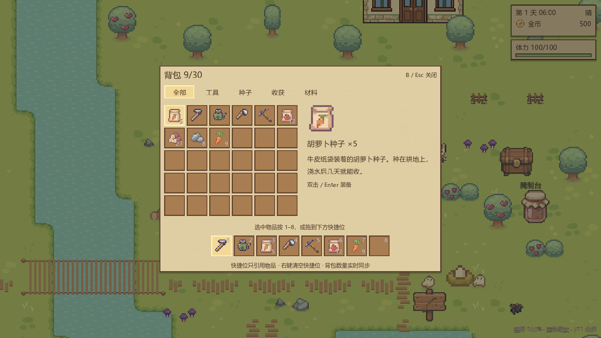
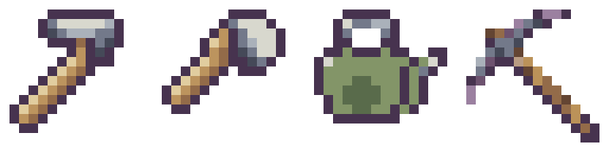

# 视野与背包互通

2026-11-03：原先世界与 UI 共用 320×180 显示基准，1280×720 下 HUD 被放大四倍，且镜头只显示 20×11.25 格。改成 640×360 基准、默认 1600×900 窗口，镜头默认 1.25 倍，约显示 32×18 格。UI 按新的基准布局，实际占屏比例缩小；镜头缩放只改变世界，不改变 UI。

镜头功能：平滑跟随、移动方向前瞻、地图边界约束、滚轮或 +/- 缩放、Home 恢复默认视野、F11 切换全屏。窗口允许缩放，镜头自动约束最小缩放，避免地图之外露空。镜头偏好存入用户设置，不覆盖农场存档。

编辑器嵌入预览可能限制显示区域。`tools/run_game.ps1` 可直接启动独立游戏窗口，默认进入标题界面；追加 `-ContinueFarm` 直接加载农场。导出运行也使用同样的默认窗口尺寸与缩放配置。

背包扩展到 30 格，工具是不可消耗、不可售卖的普通 ItemData 条目。旧版最多 24 格，读档后在空格补入四件永久工具，不丢失旧物品。八格快捷栏只引用物品 id，数量始终来自背包，绑定与选中位置一并入档。

背包提供全部、工具、种子、收获、材料五类筛选；拖动物品可换位，拖到快捷位或选中后按 1–8 可绑定，双击可装备并关闭背包。快捷位之间可拖动交换，右键清空快捷引用。工具与种子的名称、图标、数量由同一份背包数据驱动；水壶升级后图标同步变化。

所有快捷键数字是槽位自身的右上角子节点，数量显示在右下角，不再依赖工具图标的尺寸。工具图标沿用 `held_tool_painter.gd` 的可编辑像素轮廓和木柄/金属配色，通过 `tools/art/build_tool_icons.gd` 生成，石镐保留现有图形，统一其他工具的细节密度。

## 验证

`tools/check/check_inventory_hotbar_camera.gd` 覆盖数量同步、分类映射、数字绑定、真实 GUI 鼠标拖放、快捷位交换、种子耗尽不误播、工具保护、满旧档迁移、存档往返、镜头独立缩放与地图边界。`check_ui_layout.gd` 验证 1280×720、1920×1080、800×600 三种比例；独立图形进程验证 F11 全屏/窗口切换并恢复 1600×900。既有种植、动作、商店、暂停、日历、目标与体力检查通过；新增农场活动的 121 项检查也通过。

