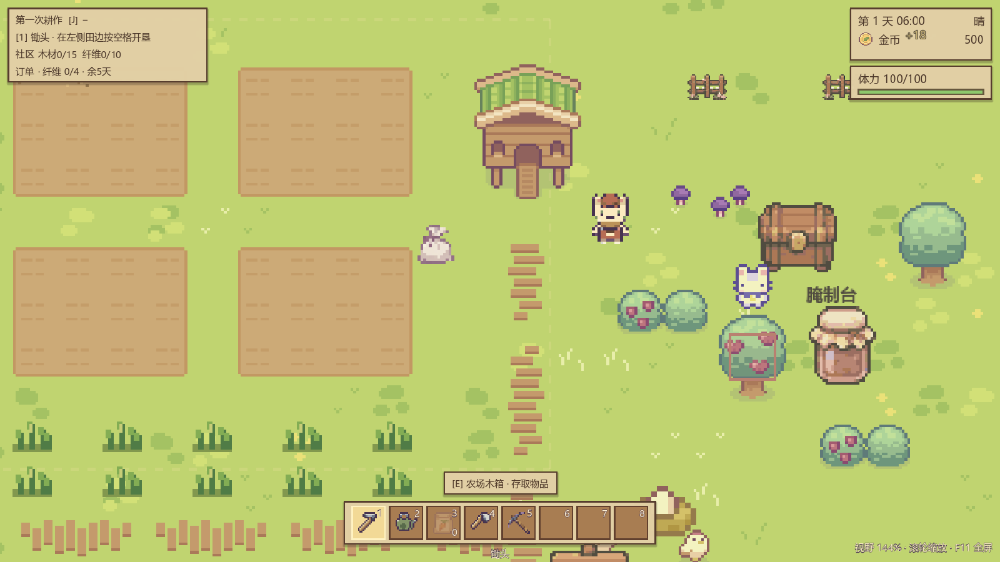
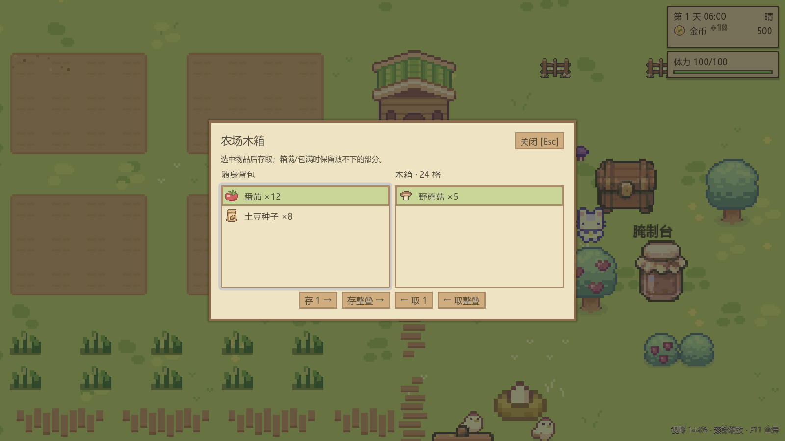
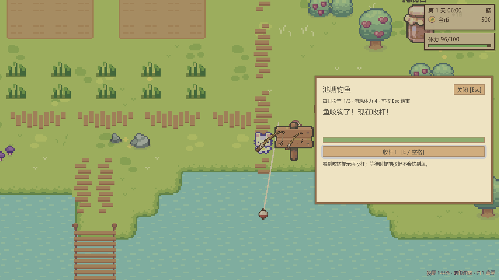
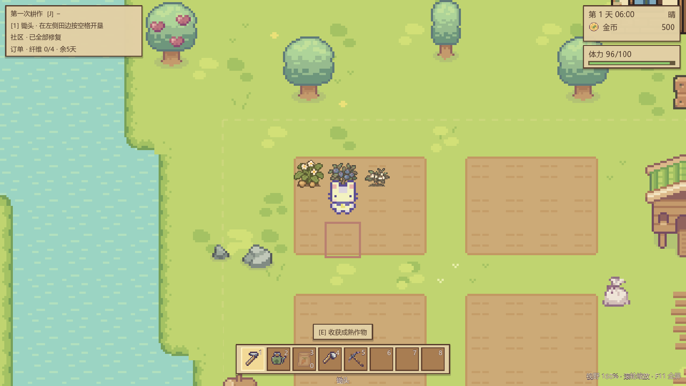
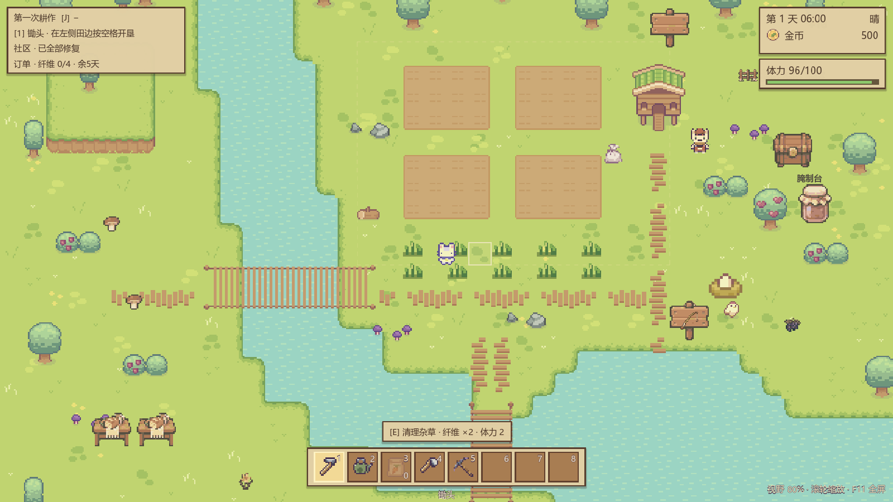

# 素材接入与农场新活动

本轮把已生成的原创素材接入可玩的农场活动。物品仍使用原背包、商店、金币、体力、时间和存档系统，未取用外部《星露谷物语》资源包中的图片。

## 已接入的玩法

| 内容 | 操作与规则 | 素材来源 |
| --- | --- | --- |
| 农场木箱 | 小屋右侧靠近按 E；24 格，存取 1 件或一叠（最多物品堆叠上限）。永久工具随身保管 | `content_v1/objects/craftables/wood_chest.png` |
| 番茄腌制台 | 木箱南侧按 E；投入 3 个番茄，过夜获得 1 瓶番茄腌菜；售价 140。投入的生番茄直接出售共 105，加工增加 35 | `content_v1/objects/craftables/preserves_jar.png`、`content_v1/icons/items/food_forage/pickles.png` |
| 三种野外采集物 | 野蘑菇、野花、野黑莓；靠近按 E，每次花 1 体力。地图有 6 个落点，每天最多补长 2 处 | `content_v1/items/food_forage/` |
| 土豆 | 商店初始出售种子，12 金币；浇水过夜 2 次成熟，收获 1 个，售价 22，收后重新播种 | `expansion_v1/crops/` 与 `expansion_v1/icons/` |
| 蓝莓 | 社区第一阶段完成后出售种子，75 金币；首收需浇水过夜 5 次，每次产出 2 份；保留植株，再浇水过夜 2 次复收，每份售价 25 | `content_v1/crops/blueberry/` 与对应图标 |
| 基础钓鱼 | 商店买竹鱼竿（80 金币，一次购买）；到南侧池塘北岸钓点按 E，按 E / 空格投竿，咬钩时再按键收杆。每日限 3 次，每次 4 体力，等待 1.5–3 秒，收杆窗口 2 秒 | `expansion_v1/fishing/`、`expansion_v1/icons/` |
| 两种鱼获 | 鲫鱼与鲤鱼，售价分别为 18 / 26；直接进入现有背包，可在商店出售 | `expansion_v1/icons/crucian_carp.png`、`common_carp.png` |
| 社区修复可视化 | 第一阶段补齐小屋东北侧围栏；第二阶段在西南岸增加两个小摊；第三阶段在社区中心南侧挂农场招牌 | `content_v1/terrain/town/spring/`、`objects/furniture/`、`objects/craftables/` |
| 明日预告 | 睡前显示预计成熟株数、腌菜领取、采集物补长和钓鱼次数恢复 | 现有睡前日报 |

“天数”指成功浇水后的过夜次数，缺水不累计。土豆与蓝莓的状态提示显示距离成熟 / 复收还需几晚。新增作物按 0.5 倍显示，保持 16 像素地块的间距和脚底锚点。

钓鱼当前是一个固定池塘钓点和两种普通鱼的最小完整流程。其他鱼、渔具、动物及建筑图片仍作为后续开发素材，不代表已实现相应系统。

## 存档与边界处理

- `farm_activities` 保存木箱槽位、已采集落点、上次刷新日、加工完成日、当日投竿次数、寄存鱼获。
- 投竿时就保存体力和次数。中途退出或关闭面板会取消该次等待，重新进入不会退还次数；已经收杆但无法入包的鱼会寄存在钓点。
- 背包满时，地上采集物、成熟作物、加工成品和寄存鱼获都保留。两颗蓝莓会先整体检查容量，避免只入包一颗后重复收获。
- 木箱只转移实际放得下的数量；存取不增加“今日收获”。普通物品按各自上限堆叠；工具不能存入，鱼竿不能重复购买。
- 读档不会重复刷新采集物、恢复投竿次数或发放社区奖励；旧档缺少新字段时使用空木箱、空加工状态等默认值。
- 新作物额外保存 `stage_age` 和 `regrowing`，旧作物数据继续按一天一阶运行。
- 木箱和钓鱼面板锁定移动并暂停日历，钓鱼等待独立计时。Esc / B 关闭面板，关窗后恢复输入，F1 和暂停菜单不叠开。

## 配置与代码入口

| 文件 | 用途 |
| --- | --- |
| `data/activities/farm_activities.tres` | 交互点位置、采集落点、鱼种、投竿次数与耗时 |
| `data/recipes/pickled_tomato.tres` | 原料、产物和加工天数 |
| `data/crops/potato.tres`、`blueberry.tres` | 阶段贴图、阶段天数、复收与显示比例 |
| `data/items/*.tres` | 新物品图标、买卖价格与解锁阶段 |
| `scripts/systems/farm_activities.gd` | 活动、每日结算与保存状态 |
| `scripts/systems/stack_store.gd` | 独立木箱数据，不创建第二套玩家背包 |
| `scripts/ui/farm_activities_panel.gd` | 木箱存取、钓鱼提示与按键 |
| `scripts/world/activity_prop.gd` | 接入已有 E 交互与 Y 排序 |
| `scripts/world/community_visuals.gd` | 按现有社区等级刷新世界摆设 |

## 验收

```powershell
godot --headless --path . --script res://tools/check/check_farm_activities.gd
# 带真实渲染的回归与截图；不要加 --headless
godot --path . --script res://tools/check/check_farm_activities.gd -- --preview
```

新活动回归覆盖 121 项断言，包括真实 E / Esc / B 输入、交互点、买鱼竿与卖鱼、满包保护、复收、JSON 存档往返、旧档兼容、每日刷新和 16:9 / 4:3 布局。测试关闭自动读档并移除保存组，不改动玩家存档。

原有 `check_crops`、`check_progression`、`check_ui_layout`、`check_inventory_hotbar_camera` 亦已通过；本轮运行这些旧检查时使用仅禁用磁盘写入的测试 Save 子类，保留内存收集 / 恢复行为。

通过 Godot 4.7.2 的 D3D12 实际渲染检查；编辑器主入口启动与当轮运行日志无错误。






